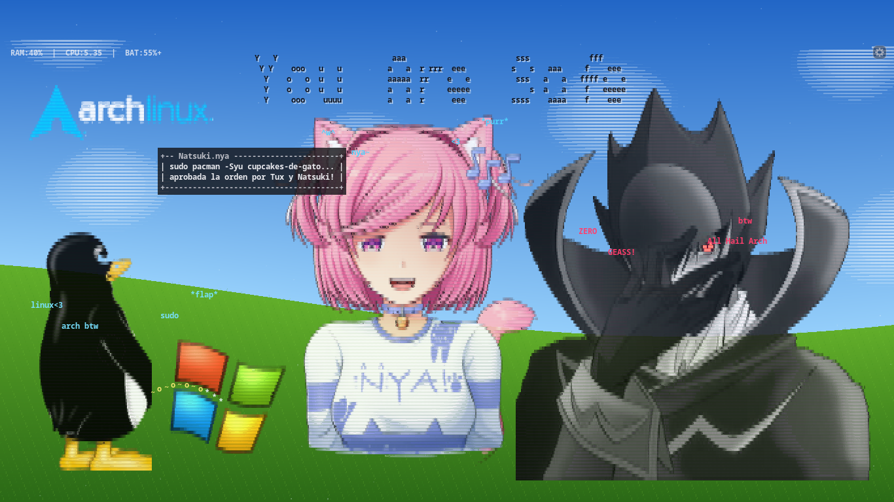

# ARCH-LINUX-ASCII-WALLPAPER

Interactive **Hyper-HD ASCII live desktop wallpaper** for **Arch Linux + Hyprland / Wayland** (`gtk-layer-shell`) combining:

- **Windows XP Bliss Meme Scene** in ASCII (`You are safe`, drifting clouds, rolling green hill, and **Tux** splashing the wavy 4-pane Windows logo)
- **Lelouch vi Britannia (Zero)** with animated pulsing **red Geass eye** + official **`archlinux`** ASCII banner
- **Natsuki (`jn_nya_cat` cat-ears sweater, bell & tail)** in Hyper-HD (`2.8pt`) ASCII with blinking, breathing, ear twitching, spring physics, and interactive dialogue bubbles
- **Monochrome minimal UI** with a tiny `20x20` gear button in the top-right corner (`Super + Alt + P` global shortcut support via `SIGUSR1`)
- **Optional PipeWire desktop audio spectrum visualizer** (`[Audio: ON]`)



---

## Arch Linux Dependencies

```bash
sudo pacman -S --needed base-devel pkgconf gtk3 gtk-layer-shell pango cairo gdk-pixbuf2
```

*(Optional for audio-reactive equalizer bars: PipeWire/PulseAudio `parec` from `libpulse`.)*

---

## Build & Run

```bash
git clone https://github.com/MegatronF0id5la4yer/ARCH-LINUX-ASCII-WALLPAPER.git
cd ARCH-LINUX-ASCII-WALLPAPER
make
./run.sh
```

Run headless/verification self-test:

```bash
make test
```

---

## Hyprland Integration (`Super + Alt + P`)

Add to your Hyprland autostart (`exec-once`):

```ini
exec-once = /path/to/ARCH-LINUX-ASCII-WALLPAPER/run.sh
```

Toggle the monochrome ASCII settings drawer from anywhere with `Super + Alt + P`:

```ini
bind = SUPER ALT, P, exec, pkill -USR1 -f '^/.*/arch-linux-ascii-wallpaper'
```

*(Or in Hyprlua `keybinds.lua`:)*

```lua
create_bind("SUPER + ALT + P", hl.dsp.exec_cmd("pkill -USR1 -f '^/.*/arch-linux-ascii-wallpaper'"))
```

---

## Interactive Controls

| Action | Trigger |
|---|---|
| Pet Natsuki's cat ears / head | Left-click ears or head (`blush` + ear twitch + bounce) |
| Ring collar bell | Left-click bell (`*ding!*`) |
| Poke sweater | Left-click torso (`angry` / `tsun` reaction) |
| Boop Tux / splash Windows | Left-click Tux or Windows flag (`*flap*` + jump) |
| Activate Geass | Left-click Lelouch (`red Geass eye flare`) |
| Arch Linux easter egg | Left-click `archlinux` logo |
| Open monochrome settings drawer | Click tiny gear icon (top-right) or `Super + Alt + P` / `H` |
| Cycle ASCII themes (`Bliss x Arch`, `Cyber Nya`, `Pastel Noche`, `Matrix Sakura`, `Tokyo Otaku`) | Right-click background or menu `[Tema]` or `T` |
| Adjust ASCII density (`Hyper`, `Ultra`, `Fino`, `Medio`, `Retro`) | Mouse scroll wheel or `D` |
| Lock expression (`1..6`) / Auto (`0`) | Keys `1..6` / `0` |
| Toggle Audio Visualizer / Rain / Tux+Lelouch | `A` / `R` / `X` |

